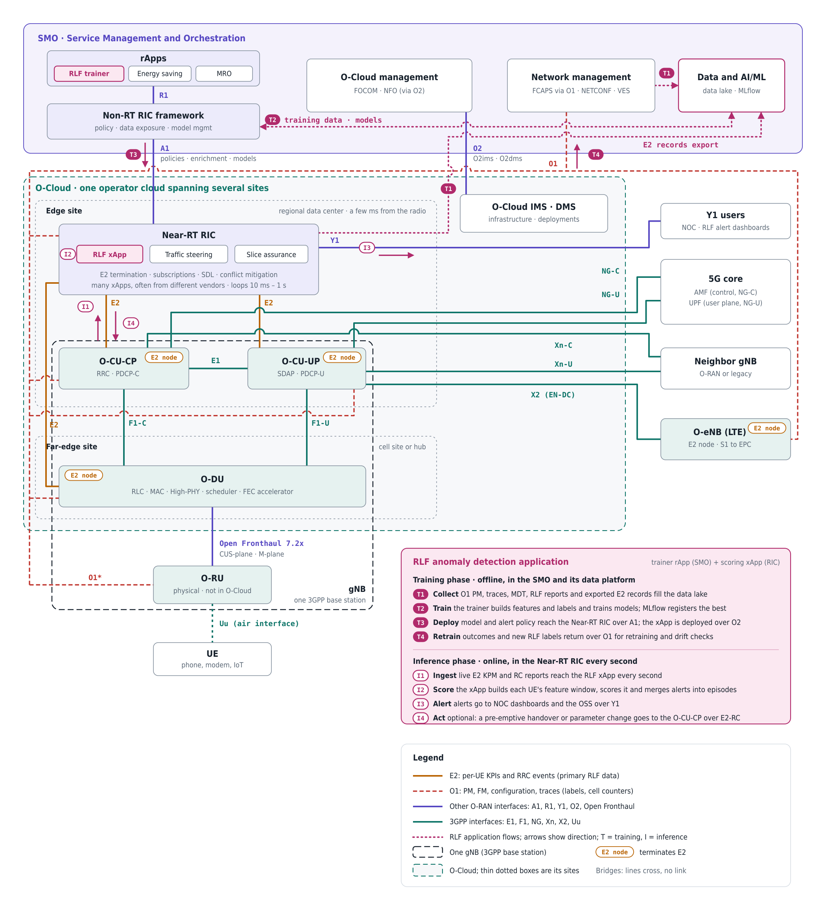

# RLF Prediction Pipeline: Files, Models and Test Results

> Radio Link Failure (RLF) prediction for O-RAN, built on an open-source MLOps stack (MLflow) and evaluated on synthetic data.

   

> **Important:** all results in this document come from **synthetic data**. None has been validated on real network data.

## Table of contents

- [O-RAN interfaces involved in this experiment](#o-ran-interfaces-involved-in-this-experiment)
  - [O-RAN in brief](#o-ran-in-brief)
  - [Nodes](#nodes)
  - [Interfaces](#interfaces)
  - [E2 in detail: the primary data source](#e2-in-detail-the-primary-data-source)
  - [O1 in detail: the secondary data source](#o1-in-detail-the-secondary-data-source)
  - [Getting the data when E2 and O1 are encrypted](#getting-the-data-when-e2-and-o1-are-encrypted)
- [Purpose and context](#purpose-and-context)
- [Repository layout](#repository-layout)
- [The three files](#the-three-files)
  - [`RLF_synthetic_data.py`](#rlf_synthetic_datapy-a-stand-in-for-real-kpm-data)
  - [`RLF_features.py`](#rlf_featurespy-features-and-labels)
  - [`RLF_train.py`](#rlf_trainpy-the-comparison-harness)
- [Quick start](#quick-start)
- [Evaluation method](#evaluation-method)
- [Model families](#model-families)
- [Results of the comparison tests](#results-of-the-comparison-tests)
- [Conclusions and caveats](#conclusions-and-caveats)
- [Next steps](#next-steps)
- [From experiment to a service assurance application](#from-experiment-to-a-service-assurance-application)
- [Evolving into an automated closed loop with the SMO](#evolving-into-an-automated-closed-loop-with-the-smo)

## O-RAN interfaces involved in this experiment

The experiment predicts radio link failures (RLF) from per-UE KPIs. In a real O-RAN deployment those KPIs travel over standard interfaces, and two of them carry everything the pipeline needs: **E2** (per-UE, per-second KPIs and RRC events, the primary source) and **O1** (labels, cell counters, configuration and traces, the secondary source). This section explains the architecture around them, then covers E2 and O1 in detail and how to obtain their data on a live network.


*Logical view based on the O-RAN Alliance architecture, for NR standalone plus EN-DC. Amber (E2) and red dashed (O1) are the two interfaces that carry the experiment's data; purple lines are the other O-RAN interfaces and teal lines are 3GPP interfaces. Arrowheads show the direction of flow: two heads where traffic runs both ways (for example E2 carries KPM reports up to the RIC and RC control down, and O1 carries PM, FM and traces up to the SMO and configuration down), one head for Y1, which exposes analytics to its consumers. The black dashed outline is one gNB, the amber tags mark E2 nodes, and the O-Cloud spans an edge site and a far-edge site. Where the RLF application itself sits is shown in a [second diagram](#rlf-application-diagram). A vector version is in [`docs/oran-architecture.svg`](docs/oran-architecture.svg).*

### O-RAN in brief

O-RAN does not replace the 3GPP 5G architecture; it builds on it. In short:

**O-RAN = 3GPP NG-RAN + an open lower-layer split + two RAN Intelligent Controllers + open management and cloud.**

- **3GPP NG-RAN, kept as is.** The gNB is split into a central unit (CU), itself split into control plane (CU-CP) and user plane (CU-UP), and a distributed unit (DU), connected by the 3GPP interfaces F1 and E1. Towards the core and other base stations nothing changes: NG, Xn and X2 are plain 3GPP, and the 5G core cannot tell an O-RAN gNB from any other.
- **Open lower-layer split (7.2x).** O-RAN splits the 3GPP gNB-DU again, into an **O-DU** and an **O-RU**, and standardizes the link between them (Open Fronthaul). 3GPP studied this split but left it proprietary, so this is what lets radios and baseband come from different vendors.
- **RAN Intelligent Controllers.** In 3GPP, radio resource management (handover decisions, load balancing, scheduling policy) sits inside the gNB and is vendor-specific. O-RAN exposes it through **E2** to a **Near-RT RIC** (control loops of 10 ms to 1 s, running xApps), steered by a **Non-RT RIC** in the SMO (loops above 1 s, running rApps) through **A1**.
- **Open management and cloud.** The **SMO** manages every element over **O1** (aligned with 3GPP SA5 management) and the cloud platform, the **O-Cloud**, over **O2**.

How the 5G NR protocol stack maps onto the nodes:

| NR layer | 3GPP node | O-RAN node |
| --- | --- | --- |
| RRC, PDCP-C | gNB-CU-CP | O-CU-CP |
| SDAP, PDCP-U | gNB-CU-UP | O-CU-UP |
| RLC, MAC, High-PHY | gNB-DU | O-DU |
| Low-PHY, RF | gNB-DU (internal) | O-RU |

Control happens at three time scales: real time (under 10 ms) inside the O-DU, for example MAC scheduling; near-real time (10 ms to 1 s) in the Near-RT RIC over E2; and non-real time (above 1 s) in the Non-RT RIC and SMO over A1 and O1. An RLF predictor with 15 to 30 s of lead time fits the near-real-time loop.

### Nodes

| Node | Role | Hosted on | gNB part | E2 node | Relevance to RLF prediction |
| --- | --- | --- | --- | --- | --- |
| **UE** | The user device. Measures the radio link and declares an RLF (timer T310 expiry) | Device | No | No | Source of RSRP, RSRQ, SINR, CQI, neighbor-cell results, A3 triggers and RLF reports, sent as RRC messages |
| **O-RU** | Low-PHY, RF and antennas | Physical hardware, outside the O-Cloud | Yes (with the O-DU it forms the gNB-DU) | No | Raw radio signals; reaches the pipeline only indirectly |
| **O-DU** | RLC, MAC, High-PHY, the real-time scheduler | O-Cloud far-edge site | Yes | Yes | Best source of per-UE, per-second KPIs: UL SINR, DL BLER, HARQ retransmissions, timing advance, power headroom, CQI |
| **O-CU-CP** | RRC and PDCP-C | O-Cloud edge site | Yes | Yes | Handover commands, measurement reports, RRC re-establishment requests and UE context releases: the network-side evidence of an RLF |
| **O-CU-UP** | SDAP and PDCP-U | O-Cloud edge site | Yes | Yes | Traffic and throughput KPIs; not needed for the current features |
| **O-eNB** | LTE base station supporting E2 and O1 | Physical or cloud | No (it is an LTE eNB) | Yes | The master node in EN-DC; reports both LTE and NR-leg failures (see below) |
| **Near-RT RIC** | Hosts xApps; terminates E2 | O-Cloud edge site | No | No (it is the other end of E2) | Natural place to collect E2 data and to run a trained model in near-real time |
| **Non-RT RIC** | Hosts rApps; part of the SMO | SMO cloud | No | No | Training, model management and policy; deploys models and policies through A1 |
| **SMO** | Service Management and Orchestration | Operator cloud (not required to be an O-Cloud) | No | No | Collects O1 data, holds the data stores and the ML platform (MLflow in this project) |
| **O-Cloud** | Cloud platform hosting the O-CU, O-DU and Near-RT RIC, with its IMS and DMS management services | Edge and far-edge sites | n/a | n/a | Infrastructure only; managed over O2 |

#### gNB and E2 nodes

- A **gNB**, in 3GPP terms, is exactly one O-CU-CP, its O-CU-UPs and its O-DUs with their O-RUs, under one gNB ID. A cell belongs to one O-DU. As the diagram shows, one gNB spans the edge site, the far-edge site and the radio.
- An **E2 node** is any RAN node that runs an E2 agent, so the Near-RT RIC can monitor and control it: the O-CU-CP, O-CU-UP, O-DU and O-eNB. The definition is about function, not radio generation. The O-RU is part of the gNB but not an E2 node.

**Why the O-eNB is an E2 node.** Most 5G traffic today still depends on LTE. In 5G non-standalone (EN-DC), the LTE eNB is the master node: it holds the RRC connection, makes mobility decisions and adds or releases the NR leg. Multi-layer use cases (LTE/NR traffic steering, dynamic spectrum sharing, layer switch-off for energy saving) need both sides, and operators want one RIC for their whole brownfield network. An LTE eNB is usually monolithic, so the whole O-eNB is a single E2 node. For RLF prediction this matters because in EN-DC both failure types go through the eNB: an **MCG failure** (RLF on the LTE leg, a real drop) and an **SCG failure** (RLF on the NR leg, reported by the UE through the eNB with SCGFailureInformation). With EN-DC traffic, many RLF labels therefore appear at the O-eNB, not at the gNB.

#### How many of each

| Relationship | Rule |
| --- | --- |
| O-CU-CP → O-DU | One CU-CP controls many DUs; each DU connects to one CU-CP (3GPP TS 38.401) |
| O-CU-CP → O-CU-UP | One CU-CP controls one or more CU-UPs; each CU-UP belongs to one CU-CP |
| O-DU → O-RU | One DU serves many RUs and cells; an RU is normally tied to one DU (shared-RU options exist) |
| Near-RT RIC → E2 nodes | One RIC handles many E2 nodes, often from several gNBs; an E2 node normally connects to one RIC |
| Non-RT RIC → Near-RT RIC | One Non-RT RIC manages many Near-RT RICs over A1 |

Typical orders of magnitude, set by vendor products rather than the specs: a handful to a few dozen cells per DU, tens to a few hundred DUs per CU-CP, and tens to hundreds of E2 nodes (often thousands of cells) per Near-RT RIC. For an RLF xApp this means: data volume scales with the RIC's whole area (tens of thousands of per-UE records per second are realistic); a UE can be followed across DUs of the same CU-CP but its history breaks at a handover to another RIC's area; UE IDs are only unique per CU-CP, so features must be keyed on gNB ID plus cell ID; and the cell hold-out score in `RLF_train.py` is the right early check for generalization across the many DUs one RIC sees.

#### Hosting: the O-Cloud and its sites

The **O-Cloud** is the cloud platform that hosts the RAN software as containers or VMs: servers, switches, accelerators and timing hardware, the cloud software (Kubernetes, SR-IOV, DPDK), and two management services reached by the SMO over O2: **IMS** (infrastructure management, through O2ims) and **DMS** (deployment management, through O2dms, often the Kubernetes API). It differs from an IT cloud in three ways: the O-DU has real-time needs (slots of 0.5 to 1 ms, so real-time kernels, CPU pinning, hugepages); forward error correction is offloaded to accelerators through O-RAN's Acceleration Abstraction Layer (AAL); and nodes hosting DUs need PTP and SyncE timing.

An O-Cloud is usually many sites, not one data center:

| Site | Distance to the radio | Hosts |
| --- | --- | --- |
| Far edge (cell site or hub) | Fronthaul under about 100 µs | O-DU |
| Edge (regional data center) | A few ms | O-CU-CP, O-CU-UP, Near-RT RIC |
| Regional or central | Tens of ms | SMO, Non-RT RIC |

The O-RU stays physical. The SMO usually runs on a cloud too, but O-RAN does not require it to be an O-Cloud, which is why it manages the O-Cloud over O2 from outside.

#### rApps and xApps

Both are third-party microservices that hold optimization logic on top of a RIC platform, which provides messaging, data storage, subscriptions, conflict handling and security. The name **xApp** comes from the xRAN Forum, one of O-RAN's founding bodies, and was used from the start in the O-RAN Software Community's Near-RT RIC. **rApp** was coined later for Non-RT RIC applications; the "r" is usually read as "RAN". Neither letter has a formal expansion in the specifications.

| | xApp | rApp |
| --- | --- | --- |
| Host | Near-RT RIC (edge site) | Non-RT RIC (SMO) |
| Control loop | 10 ms to 1 s | Above 1 s |
| Reaches the RAN through | E2, via the RIC platform API | R1, which maps to A1, O1 and O2 services |
| Data | E2 reports (KPM, RRC events) | O1 PM, FM, CM and traces, external data |
| AI/ML role | Mostly inference | Training, model management, analytics |
| RLF role in this project | Score each UE every second from E2 data; trigger a pre-emptive handover over E2-RC within policy | Retrain the model on O1 traces and labels; tune per-cell handover parameters; send A1 policies such as a cap on pre-emptive handovers |

**Many xApps share one Near-RT RIC.** A RIC typically hosts several different xApps at once, often from different vendors: for example the RLF xApp next to a traffic-steering xApp and a slice-assurance xApp, as in the [RLF application diagram](#rlf-application-diagram). They share the platform's services: E2 subscriptions (one E2 report can feed several xApps), the shared data layer (one xApp can publish results, such as per-UE RLF risk scores, for others to read), and messaging. Two consequences for the RLF application:

- **Conflicts.** Different xApps may want to change the same thing: the RLF xApp asking for a pre-emptive handover while a traffic-steering or mobility xApp moves the same UE or tunes the same handover parameters. The RIC's conflict mitigation function, and A1 policies that assign each xApp what it may control, are what keep them from fighting. Until that is settled, the RLF xApp should stay advisory (alerts only) or publish risk scores for the mobility xApp to use, rather than act itself.
- **Shared inputs, separate outputs.** Several xApps subscribing to the same E2SM-KPM and E2SM-RC data is normal and cheaper than duplicating collection, but each xApp's actions and model versions must be logged separately so outcomes can be traced to the right one.

**Many rApps share one Non-RT RIC.** The Non-RT RIC also hosts several different rApps at once, for example the RLF trainer next to an energy-saving rApp and a mobility robustness optimization (MRO) rApp, as in the [RLF application diagram](#rlf-application-diagram). R1 is what makes them portable across SMO vendors, and its data management and exposure service works as a producer and consumer system: each rApp registers the data types it publishes and subscribes to those it needs. For the RLF application:

- **Shared outputs.** The RLF trainer can publish per-cell RLF risk as a data type, which the MRO rApp can use to decide where handover parameters need tuning.
- **Overlapping actions.** The MRO rApp and any RLF-driven parameter tuning both change `a3_offset`, `hysteresis` and `ttt_ms`, and an energy-saving rApp that switches cells off changes coverage and therefore RLF risk. The SMO must decide which rApp owns which parameters and coordinate changes, in the same way the Near-RT RIC's conflict mitigation does for xApps. Until then, the RLF trainer should only train models and recommend changes, not apply them.

#### Where the RLF application sits

The RLF anomaly detection application is not one box but two cooperating components, one per RIC, plus the SMO's data and ML platform. They are pink in the [RLF application diagram](#rlf-application-diagram) below. Examples of rApp and xApp services are shown (note the rApp and xApp applications corresponding to the RLF prediction application)

<a id="rlf-application-diagram"></a>



*Pink marks its components (the RLF trainer rApp in the SMO, the data and MLflow platform, and the RLF xApp on the Near-RT RIC) and its own data flows. Filled markers T1 to T4 are the training phase, including the collection of training data; outlined markers I1 to I4 are the inference phase; arrows show the direction of each flow, and the O-RAN and 3GPP interfaces also carry arrowheads (two heads where traffic runs both ways, one head for Y1). The steps are explained in the tables below. A vector version is in [`docs/rlf-application-architecture.svg`](docs/rlf-application-architecture.svg).*

| Component | Location | Job |
| --- | --- | --- |
| **RLF trainer rApp** ("RLF trainer" in the diagram) | Non-RT RIC, in the SMO | Builds features and labels from the data lake, trains and evaluates the models (`RLF_features.py`, `RLF_train.py`), and decides the alert policy |
| **Data and AI/ML platform** | SMO | Data lake for O1 data, plus MLflow tracking and the model registry |
| **RLF xApp** | Near-RT RIC, edge site | Receives E2 data, runs the registered model, raises alerts and, optionally, mitigation |

The application works in two phases, which the RLF application diagram separates: filled markers **T1 to T4** for the training phase (including the collection of training data) and outlined markers **I1 to I4** for the inference phase. Pink arrows show the direction of each step's flow: dotted pink lines are the application's own data flows (O1 data and exported E2 records into the data lake, training data to the trainer and models back to MLflow), and short pink arrows next to an interface show which way a step uses it.

**Training phase**: offline, in the SMO and its data platform, run periodically or when quality drops.

| Step | What happens | Interfaces |
| --- | --- | --- |
| T1. Collect training data | O1 PM counters, traces, MDT and UE RLF reports flow through network management into the data lake. E2 records (KPM and RC reports) are exported from the Near-RT RIC into the same lake, because the per-UE features come from E2 | O1; E2 records exported from the RIC (separate dotted pink line, "E2 records export") |
| T2. Train and register | The trainer rApp reads the data lake, builds features and labels, trains and compares models, and registers the chosen one in MLflow | R1 (data management and exposure), inside the SMO |
| T3. Deploy | The registered model and its alert policy (threshold, alert budget, action limits) go to the Near-RT RIC; the xApp workload itself is deployed on the O-Cloud | A1 for model and policy, O2 for the xApp |
| T4. Retrain | Outcomes of the alerts (did an RLF follow?) and new RLF labels return to the data lake, for retraining and drift monitoring | O1 |

**Inference phase**: online, in the Near-RT RIC, every second.

| Step | What happens | Interfaces |
| --- | --- | --- |
| I1. Ingest live data | Live E2SM-KPM and E2SM-RC reports reach the RLF xApp | E2 |
| I2. Score | The xApp builds each UE's feature window with the same feature code and version as training, scores it, and merges alerts within one horizon into episodes | Inside the Near-RT RIC |
| I3. Alert | Alerts go to NOC dashboards and the OSS | Y1 |
| I4. Act (optional) | In the closed-loop phase, a pre-emptive handover or parameter change goes to the O-CU-CP | E2-RC |

The same E2 data serves both phases: live in I1, and as history in T1. This is why the feature code (`RLF_features.py`, `FEATURE_VERSION`) must be shared between the trainer and the xApp.

During the experiment only steps T1 and T2 exist, on synthetic data. The other steps are the path described in [From experiment to a service assurance application](#from-experiment-to-a-service-assurance-application) and [Evolving into an automated closed loop with the SMO](#evolving-into-an-automated-closed-loop-with-the-smo).

### Interfaces

| Interface | Between | Carries | Defined by | Source of experiment data? |
| --- | --- | --- | --- | --- |
| **E2** | Near-RT RIC ↔ O-CU-CP, O-CU-UP, O-DU, O-eNB | E2AP procedures carrying service models: KPM (measurements), RC (RAN control and RRC events), NI, CCC | O-RAN WG3 | **Yes, primary**: per-UE, per-second KPIs and RRC events |
| **O1** | SMO ↔ every managed element | FCAPS: configuration, performance counters, alarms, traces, software and files | O-RAN WG10, 3GPP SA5 models | **Yes, secondary**: labels, cell counters, configuration, traces |
| **A1** | Non-RT RIC → Near-RT RIC | Policies (A1-P), enrichment information (A1-EI), ML model management | O-RAN WG2 | No; the route to deploy a trained model or its policies |
| **R1** | rApps ↔ Non-RT RIC framework | Service exposure for rApps: data management and exposure (DME), A1/O1/O2 services, AI/ML workflow | O-RAN WG2 | Indirectly: how an rApp would request O1 data |
| **Y1** | Near-RT RIC → external consumers | RAN analytics, by request or subscription | O-RAN WG3 | Possibly: a route to export RIC-derived data |
| **O2** | SMO ↔ O-Cloud | Infrastructure (O2ims) and workload (O2dms) management | O-RAN WG6 | No |
| **Open Fronthaul** | O-DU ↔ O-RU | Split 7.2x: C-plane, U-plane (IQ samples), S-plane (timing), M-plane (O-RU management) | O-RAN WG4 | No (low-level radio data) |
| **E1** | O-CU-CP ↔ O-CU-UP | Bearer context management | 3GPP TS 38.46x | No |
| **F1-C / F1-U** | O-CU ↔ O-DU | F1AP signalling (UE context, RRC transfer) / user data with flow control | 3GPP TS 38.47x | Indirectly, through traces |
| **NG-C / NG-U** | O-CU ↔ 5G core (AMF / UPF) | NGAP signalling (sessions, core-side handover, paging) / user data | 3GPP TS 38.41x | Indirectly: release causes seen by the core |
| **Xn-C / Xn-U** | O-CU ↔ neighbor gNB | Handover, dual connectivity, load coordination / data forwarding | 3GPP TS 38.42x | Handover context only |
| **X2** | gNB ↔ O-eNB | EN-DC coordination (X2-C from the CU-CP, X2-U from the CU-UP) | 3GPP TS 36.42x | Handover and EN-DC context |
| **Uu** | UE ↔ O-RU | The NR air interface: RRC, measurement reports, RLF reports, user data | 3GPP TS 38.300, 38.331 | Carries the UE's measurements to the network |

E2 and O1 get their own colors in the diagram only because they carry the experiment's data; both are O-RAN interfaces like A1, R1, Y1, O2 and Open Fronthaul.

#### Protocols, data formats and tappability

"Tappable by probes" says whether a passive monitoring tool (a TAP, a mirror port or a virtual-switch mirror feeding a probe or Wireshark) can capture the traffic and read it without help from the endpoints. **Yes**: no standard encryption, readable on the wire. **Conditional**: readable only when the operator has not enabled IPsec or DTLS, which 3GPP and O-RAN require nodes to support but leave to the operator to switch on. **Restricted**: always encrypted (TLS, SSH) or not on a physical link, so the data must come from endpoint logs, collectors or vendor trace.

| Interface | Protocol stack | Data format | Tappable by probes |
| --- | --- | --- | --- |
| **E2** | E2AP over SCTP over IP | ASN.1 aligned PER (APER); service-model payloads are ASN.1 messages inside OCTET STRINGs | **Conditional**. Wireshark decodes E2AP; O-RAN security specifications call for IPsec on E2, after which a tap sees only ESP packets |
| **O1** | NETCONF over SSH or TLS (configuration) · VES over HTTPS (events) · SFTP, FTPES or HTTPS (files) · WebSocket streaming for PM | YANG-modeled XML (NETCONF) · VES JSON · PM files in 3GPP XML (TS 32.435) or ASN.1 | **Restricted**. Always encrypted; read the data at the SMO collector instead |
| **A1** | REST over HTTP/1.1 or HTTP/2 · TLS · TCP/IP | JSON; policy types described by JSON Schema | **Restricted**. Mutual TLS; read from RIC logs |
| **R1** | Service-based REST APIs (OpenAPI) · TLS with OAuth 2.0; data delivery may use a message bus such as Kafka | JSON | **Restricted**. Usually inside the SMO cluster (service mesh with mTLS); needs a virtual tap or API-gateway logs |
| **Y1** | Service-based REST APIs (OpenAPI) · TLS with OAuth 2.0 | JSON | **Restricted**. TLS-protected |
| **O2** | REST over HTTP (OpenAPI) · TLS; O2dms profiles use ETSI NFV-SOL APIs or the Kubernetes API | JSON; YAML for Kubernetes manifests and Helm charts | **Restricted**. TLS-protected |
| **Open Fronthaul** | C/U-plane: eCPRI or IEEE 1914.3 RoE over Ethernet, optionally UDP/IP · S-plane: PTP and SyncE · M-plane: NETCONF over SSH or TLS | Binary eCPRI section messages; IQ samples, often compressed (block floating point) · M-plane YANG as XML | **Yes** for the C/U-plane (MACsec is optional), with a line-rate Ethernet probe and PTP timestamps; very large volumes. The M-plane is encrypted |
| **E1** | E1AP over SCTP over IP | ASN.1 APER | **Conditional**. Often never leaves a server or cluster when both CU parts are co-located: capture then needs a virtual tap (vSwitch mirror, sidecar, eBPF) |
| **F1-C** | F1AP over SCTP over IP | ASN.1 APER; embedded RRC in ASN.1 unaligned PER (UPER) | **Conditional**. RRC inside is ciphered by PDCP once radio security is active, so only the first RRC exchange is readable without keys |
| **F1-U** | GTP-U over UDP over IP with NR-U extension headers (TS 38.425) | Binary GTP-U headers and packets | **Conditional**. Payloads are PDCP PDUs already ciphered for the radio, so user data is not readable |
| **NG-C** | NGAP over SCTP over IP | ASN.1 APER; NAS as binary containers | **Conditional**. The classic probe point; NAS inside is ciphered after NAS security mode |
| **NG-U** | GTP-U over UDP over IP | Binary GTP-U headers and the UE's IP packets | **Conditional**. Content interception is regulated (lawful interception) |
| **Xn-C / Xn-U** | XnAP over SCTP / GTP-U over UDP | ASN.1 APER / binary GTP-U | **Conditional** |
| **X2** | X2AP over SCTP (X2-C) / GTP-U over UDP (X2-U) | ASN.1 APER / binary GTP-U | **Conditional** |
| **Uu** | NR radio stack: PHY, MAC, RLC, PDCP, SDAP; RRC on the control plane | RRC in ASN.1 UPER; binary MAC and RLC headers | **Restricted**. Needs a radio sniffer; ciphered after AS security activation; sniffing public radio is legally restricted in most countries |

### E2 in detail: the primary data source

**Protocol.** E2 runs the **E2 Application Protocol (E2AP)** over SCTP over IP, encoded in ASN.1 aligned PER. E2AP itself is generic: it sets up the connection (E2 Setup, where the node announces which RAN functions and service models it supports), manages subscriptions and carries four kinds of procedure:

| Procedure | Direction | Meaning |
| --- | --- | --- |
| Report | E2 node → RIC | Send measurements or event copies, periodically or on a trigger |
| Insert | E2 node → RIC | Pause a procedure and ask the RIC for a decision (for example, the target cell of a handover) |
| Control | RIC → E2 node | Command an action (for example, trigger a handover) |
| Policy | RIC → E2 node | Install a rule the node then applies by itself |

**Service models (E2SM)** define what is observed and controlled. Two matter for this experiment:

- **E2SM-KPM** (Key Performance Measurements) reports measurements at a configured period. Besides node and cell-level reports, it has UE-level report styles (one UE, UEs matching a condition, or several UEs per report). This is where per-UE DU and CU metrics come from: PRB use and throughput, and where the vendor supports them, CQI, BLER, HARQ retransmissions, timing advance, power headroom and UL SINR.
- **E2SM-RC** (RAN Control) both controls and reports. Its "message copy" report style sends the RIC copies of selected RRC and network-interface messages: **MeasurementReport** (RSRP, RSRQ, SINR, neighbor results, A3 triggers), **RRCReconfiguration with sync** (handover commands), **RRCReestablishmentRequest** (the main RLF evidence) and **UE context release** with its cause. Its control styles are the route back into the RAN for a mitigation such as a pre-emptive handover.

**Who sees E2 data.** E2 terminates in the Near-RT RIC. xApps never open an E2 connection themselves; they subscribe through the RIC platform (E2 termination and subscription manager) and receive decoded reports. That is also why IPsec on E2 does not stop a data-collection xApp: the RIC decrypts and decodes, and the xApp is an authorized consumer.

**Caveat.** What an E2 node can report depends on the E2 service models, report styles and per-UE metrics its vendor implements. Check this before planning on 1-second per-UE DU KPIs.

### O1 in detail: the secondary data source

O1 is how the SMO manages every element (Near-RT RIC, O-CU, O-DU, O-RU through the M-plane, O-eNB). It combines two protocols plus file transfer.

**NETCONF and YANG (configuration management).** NETCONF (IETF RFC 6241) reads and changes device configuration. It runs over SSH (port 830) or TLS. The SMO is the client and each element runs a NETCONF server. Messages are XML-encoded remote procedure calls: `get` and `get-config` to read, `edit-config` to change, `lock`/`unlock` and `commit` to apply changes atomically, plus notifications. **YANG** (RFC 7950) is the data-modeling language that defines what can be configured; O1 uses the 3GPP SA5 NR resource models (gNB, cells, neighbor relations) plus O-RAN's own modules. RESTCONF (RFC 8040) offers the same YANG data over HTTP with JSON, often on the SMO's northbound side. For this project, NETCONF is how `a3_offset`, `hysteresis` and `ttt_ms` are read, and how a closed loop would change them on the O-CU-CP.

**VES (fault and performance events).** VES (VNF Event Stream) comes from the ONAP open-source project. Elements push JSON events by HTTPS POST to the SMO's VES collector, which validates them and publishes them on a message bus, usually Kafka. Every event has a common header (source, type, priority, timestamps, sequence number) and a domain body: `fault` (alarms), `measurement` and `perf3gpp` (counters), `notification` (for example "PM file ready"), `heartbeat`, and `stndDefined` (3GPP SA5 notifications inside a VES envelope).

**Files.** Bulk PM is written by each element as 3GPP XML files, usually every 15 minutes, announced with a VES notification and downloaded by SFTP, FTPES or HTTPS. Trace files (below) travel the same way.

| | NETCONF/YANG | VES |
| --- | --- | --- |
| Purpose | Configuration management | Fault and performance reporting |
| Direction | SMO → element requests, plus notifications | Element → SMO collector (push) |
| Encoding | XML following YANG models | JSON with a common header |
| Transport | SSH or TLS | HTTPS |
| Use in this project | Read handover parameters; later, change them | Alarms, cell counters (`prb_util`, `connected_ues`), file-ready notices |

O1 counters are too coarse for the per-second features, so O1 serves the label, the configuration columns, the cell counters and, through trace, the RRC evidence.

### Getting the data when E2 and O1 are encrypted

On a live network, E2 is normally protected by IPsec and O1 is always encrypted (SSH, TLS, HTTPS), so the data cannot be sniffed. Encryption protects the transport, not access: the pipeline obtains the data as an **authorized endpoint**, from the components that terminate the encryption. In order of closeness to the target product:

1. **A data-collection xApp on the Near-RT RIC (E2 data).** Subscribe to E2SM-KPM UE-level reports and E2SM-RC message copies, receive decoded records through the RIC platform, and stream them to Kafka or a data lake (or export them over Y1). The same xApp can later run the model.
2. **An rApp or SMO consumer (O1 data).** Request PM, fault and configuration data types through R1 data management and exposure, or read the SMO and OSS northbound APIs: the VES collector's Kafka topics, the PM file store and the configuration database.
3. **3GPP trace and MDT (works without a RIC).** Cell or UE trace (3GPP TS 32.421 to 32.423) records RRC, NGAP, F1AP, XnAP and X2AP messages as the node sees them, after radio deciphering and before transport encryption, and delivers them as files or streams. Immediate MDT (TS 37.320) adds periodic UE measurements, and the **UE RLF report** gives the measurements and time of each failure, the cleanest label available. Vendor call-trace exports often add the DU-level detail (BLER, HARQ, CQI, TA) that standard trace lacks.
4. **Probes where traffic is in clear.** IPsec usually terminates at a security gateway in front of the core, so NG-C and NG-U are often readable between the gateway and the core; this gives core-side release causes but no radio KPIs. Some vendors also offer node-side capture before encryption or key export to approved probes.

| Columns in `RLF_synthetic_data.py` | Best source with encryption on |
| --- | --- |
| `rsrp`, `rsrq`, `sinr`, `neighbor_rsrp`, `a3_events` | E2SM-RC message copy of MeasurementReport; or trace plus immediate MDT |
| `cqi`, `dl_bler`, `harq_retx`, `ul_sinr`, `ta`, `phr` | E2SM-KPM UE-level reports, if the O-DU supports them; otherwise vendor DU call trace |
| `ho_cmd` | E2SM-RC message copy of RRCReconfiguration with sync; or cell trace |
| `rlf` (the label) | Trace or E2SM-RC: RRCReestablishmentRequest and "radio connection with UE lost" releases; MDT RLF report for exact timing; at the O-eNB for EN-DC traffic |
| `prb_util`, `connected_ues` | O1 PM counters through DME, the SMO or the OSS (often 15-minute granularity); or E2SM-KPM cell-level reports |
| `a3_offset`, `hysteresis`, `ttt_ms` | O1 configuration read through the SMO (NETCONF), or the configuration database |

Every route needs the operator's agreement, credentials and a data agreement, and UE-level data is personal data: pseudonymize UE identifiers and limit retention. The hardest fields at 1-second resolution are the DU ones; if neither E2SM-KPM nor vendor trace provides them per UE, drop them as described in the [cautions below](#collecting-the-same-dataset-from-a-real-system). A realistic start is offline training from trace, MDT and PM exports for a pilot cluster, then a data-collection xApp once the operator's RIC and E2 nodes expose UE-level KPM and RC message copies.

### Where the experiment data can come from

In short, per-UE KPIs and RRC events come mainly from the **O-DU and O-CU over E2**, and labels, configuration and cell counters from **O1** (including trace and MDT). The column-by-column collection paths and how to build the CSV are in [Collecting the same dataset from a real system](#collecting-the-same-dataset-from-a-real-system).

*This section is based on general 3GPP and O-RAN knowledge. Which interfaces, service models, report styles and per-UE metrics are exposed varies by vendor and specification release, and it has not been checked against a specific vendor's data model.*

## Purpose and context

This is an experiment that tests failure-prediction models on the radio links of an O-RAN-based Radio Access Network, using synthetic data.

The scope is to analyze O-RAN RAN-level anomalies and implement failure-prediction models for **radio link failure (RLF)**, built on an open-source MLOps stack (MLflow).

The pipeline has three parts:

| Step | File | Job |
| --- | --- | --- |
| 1 | `RLF_synthetic_data.py` | Creates plausible per-UE KPI data with known failures |
| 2 | `RLF_features.py` | Turns that data into labelled model inputs |
| 3 | `RLF_train.py` | Trains and compares five models (four families; gradient boosting runs as both XGBoost and HistGradientBoosting) under identical conditions, logging every run to MLflow |

## Repository layout

```text
.
├── RLF_synthetic_data.py   # synthetic per-UE, per-second KPI generator
├── RLF_features.py         # 105 features + RLF label
├── RLF_train.py            # training, evaluation and MLflow logging
├── RLF_requirements.txt    # mlflow, numpy, pandas, scikit-learn, xgboost (torch is also required: add it to this file or install it separately)
└── docs/
    ├── oran-architecture.png   # O-RAN architecture diagram used in this README
    ├── oran-architecture.svg   # vector version of the same diagram
    ├── rlf-application-architecture.png   # the same architecture with the RLF application placed in it
    └── rlf-application-architecture.svg   # vector version
```

## The three files

Each file does one job in a chain: generate data, build features and labels, then train and compare models.

### `RLF_synthetic_data.py`: a stand-in for real KPM data

**Scope:** `generate_dataset(n_ues=60, n_seconds=3600, n_cells=12, seed=7, episode_rate=1/400, sudden_rlf_rate=1/6000)` returns one row per UE per second (216,000 rows in the default run) and **22 columns**.

**Acronyms**

| Acronym | Meaning |
| --- | --- |
| KPM | Key Performance Measurement: the O-RAN E2 service model (E2SM-KPM) that reports measurements from the RAN to the near-RT RIC |
| KPI | Key Performance Indicator: a measured or derived quantity describing network or link quality |
| UE | User Equipment: the phone, modem or IoT device |
| RLF | Radio Link Failure: the UE declares that its radio link to the serving cell is lost |
| RRC | Radio Resource Control: the signalling protocol between the UE and the gNB (measurement reports, handover commands) |
| RSRP | Reference Signal Received Power: strength of the cell's reference signal, in dBm |
| RSRQ | Reference Signal Received Quality: RSRP relative to the total received power, in dB |
| SINR | Signal-to-Interference-plus-Noise Ratio, in dB |
| UL / DL | Uplink (UE to network) / downlink (network to UE) |
| TA | Timing Advance: the timing correction the network sends to the UE, which grows with distance and with link problems |
| PHR | Power Headroom Report: how much more transmit power the UE could use, in dB |
| CQI | Channel Quality Indicator: the UE's report of downlink channel quality, an index from 1 to 15 |
| BLER | Block Error Rate: share of transmitted blocks received in error |
| HARQ | Hybrid Automatic Repeat Request: the fast retransmission mechanism at the MAC layer |
| A3 | The RRC measurement event "a neighbor cell becomes better than the serving cell by an offset", which usually triggers a handover |
| TTT | Time To Trigger: how long the A3 condition must hold before the UE reports it |
| PRB | Physical Resource Block: the unit of radio resource allocated to users; PRB utilization measures cell load |
| AR(1) | First-order autoregressive process: a slowly wandering random signal, used for the normal KPI background |

**Columns (22):**

<table>
<thead>
<tr><th>#</th><th>Group</th><th>Column</th><th>Meaning</th><th>Unit and typical value in the generator</th></tr>
</thead>
<tbody>
<tr>
<td align="center">1</td>
<td rowspan="3" align="center" valign="middle"><b>Identifiers and time</b></td>
<td><code>ue_id</code></td><td>Identifier of the simulated UE</td><td>Integer, 0 to <code>n_ues - 1</code> (pseudonymous in real data)</td>
</tr>
<tr>
<td align="center">2</td>
<td><code>cell_id</code></td><td>Serving cell of the UE</td><td>Integer, 0 to <code>n_cells - 1</code>; fixed for each UE in this generator</td>
</tr>
<tr>
<td align="center">3</td>
<td><code>t</code></td><td>Time of the row</td><td>Second index, 0 to <code>n_seconds - 1</code></td>
</tr>
<tr>
<td align="center">4</td>
<td rowspan="4" align="center" valign="middle"><b>Radio signal</b></td>
<td><code>rsrp</code></td><td>RSRP of the serving cell</td><td>dBm; about -86, wandering slowly, falls by 18 to 32 dB during a degradation episode</td>
</tr>
<tr>
<td align="center">5</td>
<td><code>rsrq</code></td><td>RSRQ of the serving cell</td><td>dB; about -10.5, follows <code>rsrp</code></td>
</tr>
<tr>
<td align="center">6</td>
<td><code>sinr</code></td><td>Downlink SINR</td><td>dB; about 18, follows <code>rsrp</code></td>
</tr>
<tr>
<td align="center">7</td>
<td><code>neighbor_rsrp</code></td><td>RSRP of the best neighbor cell</td><td>dBm; about -96, rises during an episode so the gap to the serving cell closes</td>
</tr>
<tr>
<td align="center">8</td>
<td rowspan="4" align="center" valign="middle"><b>Link and uplink</b></td>
<td><code>ta</code></td><td>Timing advance of the UE</td><td>Index steps; about 20, drifts slowly and grows during an episode</td>
</tr>
<tr>
<td align="center">9</td>
<td><code>phr</code></td><td>Power headroom of the UE</td><td>dB; about 14, falls as the link degrades</td>
</tr>
<tr>
<td align="center">10</td>
<td><code>ul_sinr</code></td><td>Uplink SINR</td><td>dB; about <code>sinr</code> minus 3 plus noise</td>
</tr>
<tr>
<td align="center">11</td>
<td><code>cqi</code></td><td>Channel quality indicator reported by the UE</td><td>Integer 1 to 15; derived from <code>sinr</code></td>
</tr>
<tr>
<td align="center">12</td>
<td rowspan="2" align="center" valign="middle"><b>Link quality</b></td>
<td><code>dl_bler</code></td><td>Downlink block error rate</td><td>Fraction 0 to 1; about 0.04, rises with degradation</td>
</tr>
<tr>
<td align="center">13</td>
<td><code>harq_retx</code></td><td>HARQ retransmission rate (share of transmissions that need a retransmission)</td><td>Fraction 0 to 1; about 0.07, rises with degradation</td>
</tr>
<tr>
<td align="center">14</td>
<td rowspan="2" align="center" valign="middle"><b>Handover events</b></td>
<td><code>a3_events</code></td><td>Number of A3 events (neighbor better than serving by the offset) in that second</td><td>Count, usually 0; more likely when the neighbor exceeds the serving cell by more than the A3 offset</td>
</tr>
<tr>
<td align="center">15</td>
<td><code>ho_cmd</code></td><td>1 in the second a handover command is issued, otherwise 0</td><td>0 or 1; set at the end of an episode that ends in a handover (not a model input)</td>
</tr>
<tr>
<td align="center">16</td>
<td rowspan="2" align="center" valign="middle"><b>Cell load</b></td>
<td><code>prb_util</code></td><td>PRB utilization of the serving cell (cell load)</td><td>Fraction 0.02 to 0.99; per-cell level with a slow daily-like swing</td>
</tr>
<tr>
<td align="center">17</td>
<td><code>connected_ues</code></td><td>Number of UEs connected to the serving cell</td><td>Count; about 5 plus 60 times the load</td>
</tr>
<tr>
<td align="center">18</td>
<td rowspan="3" align="center" valign="middle"><b>Handover configuration</b></td>
<td><code>a3_offset</code></td><td>Offset the neighbor must exceed for an A3 event</td><td>dB; 2, 3 or 4, fixed per cell</td>
</tr>
<tr>
<td align="center">19</td>
<td><code>hysteresis</code></td><td>Hysteresis added to the A3 condition to avoid ping-pong</td><td>dB; 1 or 2, fixed per cell</td>
</tr>
<tr>
<td align="center">20</td>
<td><code>ttt_ms</code></td><td>Time-to-trigger of the A3 event</td><td>Milliseconds; 160, 320 or 480, fixed per cell</td>
</tr>
<tr>
<td align="center">21</td>
<td rowspan="1" align="center" valign="middle"><b>Time of day</b></td>
<td><code>hour_of_day</code></td><td>Hour of day of the row</td><td>Integer 0 to 23; the clock starts at 08:00, so it is constant 8 in a one-hour run</td>
</tr>
<tr>
<td align="center">22</td>
<td rowspan="1" align="center" valign="middle"><b>Failure flag</b></td>
<td><code>rlf</code></td><td>1 in the second a radio link failure occurs, otherwise 0</td><td>0 or 1; set at the end of an episode that ends in an RLF, or at a sudden RLF; the label is built from it</td>
</tr>
</tbody>
</table>

The 17 raw inputs used in `RLF_features.py` are these 22 columns minus five that are never inputs (`ue_id`, `cell_id`, `t`, `ho_cmd` and `rlf`). The `rlf` column becomes the `label` there, giving 105 model inputs plus the label.

**How it creates failures:**

Slowly wandering KPI signals form the normal background (an AR(1) helper, `_ar1`). On top of that, two per-second probabilities, tested independently for every UE, create the failures:

| Parameter | Default | What it controls | Effect |
| --- | --- | --- | --- |
| `episode_rate` | 1/400 | Chance per second, while no episode is running, that a **degradation episode** starts. Gaps between episodes are random, averaging about 400 s | The episode lasts 10 to 45 s and ramps the serving signal down by 18 to 32 dB: this is the warning sign the models learn. It ends in an RLF (55%), a handover command (25%) or a recovery (20%), and a 5 s pause follows before another can start |
| `sudden_rlf_rate` | 1/6000 | Chance per second, outside episodes, of an RLF **with no degradation before it** | The KPIs stay normal, so no model can predict these failures. This gives about 0.6 sudden RLFs per UE-hour |

An episode cycle is about 400 s of waiting plus about 27 s of episode plus the 5 s pause, roughly 430 s, so about 8 episodes per UE-hour, of which about 55% end in an RLF. With the sudden failures, the default run gives about 5 RLFs per UE-hour (325 events, 5.4 per UE-hour measured), far more than a real network. About 11% of the RLFs are sudden, which caps event recall near 89%.

For a more realistic dataset with rarer failures, lower both rates (for example `episode_rate=1/4000`), and expect a much lower PR-AUC and the need for more UEs or a longer duration to keep enough events to train on.

**Known simplifications:**

- `ttt_ms`, `hour_of_day` (constant 8 in the default run), `prb_util` and `connected_ues` carry no failure signal.
- Recovery is abrupt.
- There is no spatial structure.

#### Collecting the same dataset from a real system

A real network can supply the same per-UE, per-second table, but mainly through E2 reporting or vendor traces, because the standard 15-minute performance counters are far too coarse. The [interfaces table above](#interfaces) shows where each node and interface sits.

**Where the data can come from**

- **O-RAN near-RT RIC (E2 interface).** An xApp subscribes to E2SM-KPM measurements from the O-DU and O-CU (per cell and, depending on what the E2 node supports, per UE) and can receive RRC events through E2SM-RC. Records stream into a store such as Kafka or InfluxDB. This is the path closest to the target product, and the same xApp can later run the trained model.
- **Vendor RAN traces.** Call-trace and cell-trace exports from the vendor's OSS carry per-UE measurement reports, handover and failure events. 3GPP Minimization of Drive Tests (MDT) adds UE-reported RSRP, RSRQ and power headroom.
- **SMO and the O1 interface.** O1 delivers performance counters, alarms, configuration data and trace files from every managed element (near-RT RIC, O-CU, O-DU, O-RU). Counters usually arrive in 15-minute files, so use them for `prb_util`, `connected_ues`, handover parameters and labels, not for second-level KPIs. It needs no near-RT RIC and is available on most commercial networks.
- **Test beds and open datasets.** srsRAN or OpenAirInterface with an E2 agent, Colosseum and OpenRAN Gym, POWDER, Arena, COSMOS and ColO-RAN expose the same interfaces and produce the same kind of records without touching a live network.
- **An operator design partner.** The route to real RLF volume and realistic variety.

A practical starting point is a **hybrid**: E2 for the fast per-UE KPIs, O1 for labels, configuration and cell counters, joined by UE, cell and time into one CSV for `RLF_train.py`.

**Where each column comes from**

| Column | Measured at | Reaches the pipeline through | Notes |
| --- | --- | --- | --- |
| `ue_id`, `cell_id`, `t` | O-CU-CP / O-DU | Pseudonymized RAN UE identifier, serving cell identity (NR cell ID or PCI), and a timestamp resampled to 1 s | The UE identifier often changes with the cell, so keep rows linked across handovers |
| `rsrp`, `rsrq`, `sinr`, `neighbor_rsrp`, `a3_events` | UE | Uu (RRC measurement reports with serving and neighbor results and A3 event triggers) → O-DU / O-CU-CP → **E2 (KPM)** or **O1 traces** | The reporting period is configured by the network, so check it gives about 1 s resolution |
| `cqi` | UE | Uu (CSI report) → O-DU → **E2 (KPM)** or **O1 traces** | |
| `ta`, `phr` | O-DU (MAC/PHY): timing advance and the UE's power-headroom reports | **E2 (KPM)**, or vendor traces over **O1** | Per-UE, per-second availability depends on the vendor and on the E2 service models the node supports |
| `ul_sinr`, `dl_bler`, `harq_retx` | O-DU (PHY/MAC): uplink SINR, HARQ ACK/NACK results and retransmission counts | **E2 (KPM)**, or vendor traces over **O1** | Same availability caveat as above |
| `ho_cmd` | O-CU-CP: handover commands (RRC reconfiguration with synchronization) | **E2 (RC)** event triggers, or **O1** traces | Useful to label handovers and to separate handover failures (timer T304) from RLFs |
| `prb_util`, `connected_ues` | Cell level, O-DU / O-CU: PRB usage and RRC-connected users, as defined in 3GPP TS 28.552 | **O1** PM counters, or E2-KPM cell measurements | Coarse (often 15 minutes) over O1 |
| `a3_offset`, `hysteresis`, `ttt_ms` | O-CU-CP: handover (A3) measurement configuration | **O1** configuration management, or the RRC configuration | Changes rarely, so low-rate collection is enough |
| `hour_of_day` | Derived from the timestamp | n/a | |
| `rlf` (the label) | The UE declares it; the network sees the consequence | **O1** traces and counters; RRC re-establishment requests and "radio connection with UE lost" releases at the O-CU; **E2-RC** events; the UE RLF report | Defined [below](#recognizing-an-rlf-in-real-data); the network sees it late |

The network does not see an RLF directly, because the UE declares it (for example when timer T310 expires). Network-side evidence includes RRC re-establishment requests, UE context releases with the cause "radio connection with UE lost", and UE RLF reports. Choose one operational definition and keep it fixed, since it defines the label.

**How to build the CSV**

1. Pick a pilot cluster of cells, agree access and privacy terms, and pseudonymize UE identifiers (never store IMSI or phone numbers).
2. Collect for several weeks across busy and quiet periods. Real RLFs are far rarer than the synthetic 5.4 per UE-hour, so the number of RLF events, not rows, limits what can be learned.
3. Resample each UE to a contiguous 1-second grid and join per-UE records with cell counters and configuration by cell and time. Fill short gaps carefully and mark long ones, because `make_labels` assumes no missing seconds per UE.
4. Keep a UE's rows linked across handovers (the identifier often changes with the cell), so rolling features follow the UE.
5. Derive `rlf` from the chosen failure event.
6. Export one CSV with the same column names and run `python RLF_train.py --csv real_kpm.csv --horizon 30`.

**Cautions**

- Per-UE, per-second reporting is not available from every vendor or E2 node. If a column such as `ul_sinr`, `ta`, `phr` or `harq_retx` is missing, remove it from `RLF_features.py` (the raw columns and the rolling list) and from the GRU's channel list, and bump `FEATURE_VERSION`.
- Positives will be much scarcer, so expect lower PR-AUC, and consider a longer horizon or more data.
- UE-level traces are personal data in most jurisdictions: pseudonymize and agree retention with the operator.
- Models trained on one vendor or cell type may need retraining elsewhere; the cell hold-out score is the early warning.

**Closing the loop:** a model trained and tracked in the SMO (MLflow) is deployed to the near-RT RIC as an **xApp**, which scores each UE every second, because that is where the per-UE E2 data arrives and where a 15 to 30 s warning can still be acted on. A trainer **rApp** in the SMO runs the training and retraining pipeline and delivers the model and the alert policy to the xApp over **A1**; the xApp is deployed through the SMO over **O2**. Mitigation actions (for example a handover or parameter change) are sent back to the RAN by the xApp over **E2-RC**. Scoring in an rApp is possible only for slower, cell-level uses (see [Deployment options](#deployment-options)) and would need a different model from the per-UE one in this repository.

*This mapping comes from general 3GPP and O-RAN knowledge. Which interfaces, service models and per-UE metrics are exposed varies by vendor and release, and it has not been checked against a specific vendor's data model.*

### `RLF_features.py`: features and labels

**Scope:** turns the raw rows into 105 model inputs plus a label (feature version `rlf_features_v1`).

**Label:** `make_labels` marks a row `1` if an RLF occurs for the same UE in the next `horizon` seconds, `(t, t + horizon]`. Every row in that window is positive, not just one. The failure second itself is not.

**Features:** all look backward, so nothing from the future leaks in. Rolling work is done per UE, and missing values at the start of a UE's history are set to 0.

| Group | Count | Content |
| --- | --- | --- |
| Raw columns | 17 | `rsrp`, `rsrq`, `sinr`, `neighbor_rsrp`, `ta`, `phr`, `ul_sinr`, `cqi`, `dl_bler`, `harq_retx`, `a3_events`, `prb_util`, `connected_ues`, `a3_offset`, `hysteresis`, `ttt_ms`, `hour_of_day` |
| Derived instantaneous values | 2 | `nb_gap = neighbor_rsrp - rsrp`; `a3_margin = nb_gap - a3_offset - hysteresis` |
| Rolling-window statistics | 80 | 10 signals × 2 windows (5 s, 30 s) × 4 statistics (mean, std, min, slope) |
| Event and timing features | 6 | `a3_count_5s`, `a3_count_30s`, `ho_count_30s`, `gap_pos_frac_30s`, `secs_since_a3`, `ta_drift_10s` |

The 10 rolling signals are `rsrp`, `rsrq`, `sinr`, `ul_sinr`, `cqi`, `dl_bler`, `harq_retx`, `ta`, `phr` and `nb_gap`. Identifiers and labels (`ue_id`, `cell_id`, `t`, `rlf`, `ho_cmd`, `label`) are never inputs.

#### Recognizing an RLF in real data

In real data the `rlf` column, and therefore every label, comes from evidence on both sides of the radio link, because the UE declares the failure and the network sees it only indirectly.

**What happens at an RLF:** the UE's physical layer repeatedly reports "out of sync" and starts timer T310. If the link does not recover before T310 expires, the UE declares a radio link failure. Random-access failure and reaching the maximum RLC retransmissions are other triggers. The UE then selects a cell and sends an RRC re-establishment request; if that fails, it falls back to idle and the connection is lost.

| Evidence | Where it appears | What it tells you |
| --- | --- | --- |
| RRC re-establishment request with a failure cause (for example `otherFailure`) | gNB or CU RRC logs and traces | Best sign of an RLF the UE recovered from |
| UE context release with the cause "radio connection with UE lost" | NGAP, F1AP or XnAP messages, traces, abnormal-release counters (cause names vary by interface and vendor) | An RLF the UE did not recover from |
| UE RLF report | Reported by the UE on request (UE Information procedure) | Measurements at failure, failed cell, failure type and time of failure |
| UE-side logs | Drive-test and modem logs | T310 start and expiry, the most precise timestamp |
| Counters | OSS performance data | Re-establishment attempts and abnormal releases per cell: useful to check totals, too coarse to label a second |

**Pitfalls when labelling**

- **The network sees it late.** A re-establishment request arrives after T310 plus the UE's cell search, so the event can lag the true failure by hundreds of milliseconds to a few seconds. Labelling the arrival time biases measured lead times short; subtract the typical delay or use the failure time from the RLF report when available.
- **Handover failures are different.** A failure during handover (timer T304) also leads to re-establishment but has a different cause. Decide whether it counts as an RLF and keep the definition fixed.
- **One failure can produce several records,** such as a re-establishment request followed by a release. Merge events from the same UE within a few seconds into one RLF.
- **Not every release is a failure.** Normal releases, inactivity, network-initiated releases for load and a user switching off the phone should not count.
- **Choose the scope:** recovered RLFs only, or also those that end in a lost connection. For prediction, both are worth catching.

*This describes general 3GPP behavior and has not been checked against a specific vendor's data model.*

### `RLF_train.py`: the comparison harness

**Scope:** trains the model families on identical splits, scores them with identical metrics and logs each family as one MLflow run (experiment `oran-rlf-prediction`).

**What each run logs**

- Parameters, tags (dataset, feature version, horizon) and the averaged metrics.
- `features.json`, plus feature importances for XGBoost and the learned statistics for the z-score and the GRU.
- The trained model, named per family and horizon (for example `rlf_xgboost_h30s` or `rlf_hist_gradient_boosting_h30s`).

**Command-line options:** `--horizon`, `--n-ues`, `--seconds`, `--seed` (data), `--n-splits`, `--csv` (real data with the same columns), `--tracking-uri`, `--experiment`, `--gru-window` (default 60) and `--gru-epochs` (default 12). There is no option to skip the GRU, so PyTorch and XGBoost must both be installed.

**Constants in the code:** `SEED = 42` (model randomness) and `TARGET_FPR = 0.01` (false-alarm rate used to set the alert threshold).

## Quick start

```bash
pip install -r RLF_requirements.txt
pip install "torch>=2.2"                      # required: RLF_train.py imports it unconditionally

# 5 s horizon
python RLF_train.py --horizon 5

# 30 s horizon, GRU with a 30 s window (the default is 60 s)
python RLF_train.py --horizon 30 --gru-window 30

# --seed sets the data seed; the model seed is the SEED constant in RLF_train.py
python RLF_train.py --horizon 30 --seed 8

mlflow ui                                # http://127.0.0.1:5000
```

## Evaluation method

Every family is trained and scored on the same time-ordered splits, so differences come from the model and not from the data it saw.

**Splits**

- **4 rolling-origin time folds.** Train on the first 50%, 62.5%, 75% and 87.5% of the time range, then test on the next 12.5% after a gap (embargo) equal to the horizon. The gap stops the last training labels from reaching into the test period. Reported metrics are the average over the 4 folds.
- **1 cell hold-out.** Train on the early period (before 70% of the time) using about 75% of the cells; test on the other 25% of cells in the later period. It checks generalization to unseen cells.
- **1 final model** trained on all the data and logged to MLflow. It has no test score.
- Inside training, the GRU holds out the last 15% of its training period to choose the best epoch, and scikit-learn's HistGradientBoosting uses its own internal early-stopping validation when the data is large.

**Alert threshold:** each model outputs a risk score per UE-second. In every test fold the threshold is set at the 99th percentile of the scores of normal rows (`1 − TARGET_FPR`, with `TARGET_FPR = 0.01`), so 1% of normal seconds raise an alert. This gives every model the same false-alarm budget. Because it is computed from the test labels, a live system would need a threshold fixed in advance.

**Metrics**

| Metric | What it measures | Better |
| --- | --- | --- |
| `pr_auc` | Ranking quality over all thresholds (average precision); chance level equals the positive rate | Higher |
| `recall_at_1pct_fpr` | Share of pre-failure rows flagged at the 1% false-alarm threshold | Higher |
| `event_recall` | Share of RLF events with at least one alert in the horizon before them | Higher |
| `median_lead_s` | Median seconds between the first alert and the failure, over caught events | Longer, up to the horizon |
| `alert_episodes_per_ue_hour` | Separate alert bursts per UE-hour (alerts within one horizon are merged) | Lower |
| `infer_us_per_sample` | Scoring time per row, in microseconds | Lower |
| `cell_holdout_pr_auc` | `pr_auc` on unseen cells | Higher |

The column name `recall_at_1pct_fpr` is fixed in the code and matches the current `TARGET_FPR = 0.01`. If `TARGET_FPR` is changed (for example to 0.02), the name stays the same but the value then refers to the new rate.

## Model families

The four families (five models, because gradient boosting runs as both XGBoost and HistGradientBoosting) run from the simplest rule to a deep-learning model, so each step has to earn its extra complexity.

| Family | Learning type | Input | How it scores a row |
| --- | --- | --- | --- |
| Robust z-score | Unsupervised, labels ignored | 6 engineered features | Largest absolute robust z-score among the 6 features |
| Isolation Forest | Unsupervised, but trained on normal rows only | All 105 features | Negative of scikit-learn's `score_samples`: a short average path through random trees means more anomalous |
| Gradient boosting: XGBoost and HistGradientBoosting (two separate runs) | Supervised classifier | All 105 features | Predicted probability of an RLF within the horizon |
| GRU (PyTorch) | Supervised sequence model | Last 30 or 60 s of 13 raw KPI channels | Sigmoid of the network's output after reading the window |

**Why these four:** the z-score shows how far a simple statistical rule goes; Isolation Forest is an anomaly detector that needs no failure labels; boosting is the standard strong learner for tabular data; and the GRU tests whether a sequence model reading raw KPIs adds anything.

### Robust z-score baseline

The 6 features are `rsrp_slope_5s`, `sinr_slope_5s`, `nb_gap`, `dl_bler_mean_5s`, `harq_retx_mean_5s` and `ta_slope_30s`. The median and MAD (median absolute deviation) of each, computed on all training rows, are the only learned values (12 numbers). It has no randomness.

### Isolation Forest

- **Hyperparameters:** `n_estimators=200`, `contamination="auto"` (logged but unused, because scores are read directly), `random_state=SEED`; scikit-learn defaults for the rest (256 rows per tree, all features).
- **Learned:** the structure of the 200 random trees (which feature and split value at each node).
- **Idea:** each tree splits the data at random; unusual rows are isolated in fewer splits.

### Gradient boosting

- **XGBoost hyperparameters:** `n_estimators=300`, `max_depth=6`, `learning_rate=0.05`, `subsample=0.8`, `colsample_bytree=0.8`, `scale_pos_weight=sqrt(neg/pos)`, `random_state=SEED`.
- **HistGradientBoosting:** a separate model run next to XGBoost (not a fallback in the current code); `max_iter=300`, `max_depth=6`, `learning_rate=0.05`, `class_weight="balanced"`; its internal early stopping may keep fewer than 300 trees.
- **Learned:** the trees (split features, thresholds, leaf values). Each new tree corrects the errors of the previous ones, and their summed outputs go through a sigmoid.
- **XGBoost versus HistGradientBoosting:** the same algorithm family with near-identical accuracy in these tests. XGBoost scores about 3× faster at the 5 s horizon and 7 to 8× faster at 30 s, and gives feature importances.

### GRU

- **Hyperparameters:** window 60 s by default (`--gru-window`; the class default of 30 s is overridden by the command line), 1 layer with 32 hidden units, 12 epochs, batch 512, AdamW with learning rate 0.002 and weight decay 1e-4, gradient clipping at 1.0, positive-class weight `sqrt(neg/pos)`.
- **Learned parameters:** 4,545 weights (GRU input weights 1,248; recurrent weights 3,072; biases 192; output layer 33).
- **Idea:** the GRU (Gated Recurrent Unit) reads the window second by second and keeps a memory vector, using an update gate and a reset gate to decide what to keep. The final memory goes through a linear layer and a sigmoid.
- **Input:** 13 raw channels (the 10 KPIs `rsrp`, `rsrq`, `sinr`, `ul_sinr`, `cqi`, `dl_bler`, `harq_retx`, `ta`, `phr` and `a3_events`, plus `nb_gap`, `a3_margin` and `ho_cmd`). It does not see the 80 rolling features, because it is meant to learn its own temporal summaries from the raw KPIs.
- **Training:** inputs are standardized with training-set statistics, and the best epoch is chosen on a validation slice taken from the end of the training period.

#### How the GRU reads its input: window, channels, batch and epoch

The GRU is trained on blocks of shape `(batch, window, channels)`, for example (512 windows, 60 seconds, 13 signals).

| Term | Value | Meaning |
| --- | --- | --- |
| Window | 60 s by default, 30 s in some runs (`--gru-window`, logged as `window_s`) | The stretch of recent history read for one prediction: for second *t*, the rows from *t−N+1* to *t* of the same UE, where *N* is the window value |
| Channels | 13 | One input signal measured every second (the raw KPIs listed above). PyTorch calls this `input_size`. "Channel" separates these raw signals from the 105 engineered features of the other models; it has nothing to do with radio channels. A channel holds the raw value at every time step. |
| Batch | 512 | A set of 512 independent windows, randomly drawn from the training rows, each made of consecutive seconds of one UE, so a batch mixes many UEs and different moments in time. The weights are updated once per batch. |
| Epoch | 12 at most | One pass over **all** the training windows, which means many batches. A pass over a single batch is an **iteration** (or step): one weight update. In the first time fold there are about 92,000 training windows, so one epoch is about 180 iterations (92,000 / 512). After each epoch the model is scored on the validation slice, and the weights of the best epoch (by PR-AUC) are kept, so the final model may come from an earlier epoch. |
| Hidden size | 32 | Size of the GRU's memory vector; independent of the input shape |

The relationship is **windows per epoch = batch size × iterations per epoch**.

There is one window per UE-second, so the number of windows equals the number of rows. Windows slide one second at a time, so consecutive windows overlap almost completely. They look backward only and never mix UEs. In the first seconds of a UE's data, the first available second is repeated to fill the window. The GRU's memory state is reset for every window: it carries memory only across the rows inside one window.

**Window and horizon are independent.**

- The horizon is set by the use case (how much warning an action needs); the window is set by how long the warning signs last, which in the synthetic data is a ramp of 10 to 45 s.
- A window longer than the horizon is common and fine, a shorter one also works, and equal values are only a coincidence of the defaults.
- In the tests, horizon 30 s with a 30 s window gave a PR-AUC of 0.441 and with a 60 s window 0.432, a difference within seed noise. A longer window costs more computation, since the GRU processes every second of it.

**The label depends only on the horizon, never on the window.** For the sample at *t* = 100 with a 60 s window and a 30 s horizon, the input is seconds 41 to 100 and the label is whether an RLF occurs in seconds 101 to 130. A 30 s window changes only the input; a 5 s horizon changes only the label. The train/test gap (embargo) equals the horizon, because labels look ahead; the window only reads the past and needs no gap.

Three different "windows" appear in this project:

| Name | Where | Meaning |
| --- | --- | --- |
| GRU window (30 or 60 s) | `--gru-window` | How much past the GRU reads as input |
| Rolling-feature windows (5 s and 30 s) | `RLF_features.py` | Spans over which means, standard deviations, minimums and slopes are computed for the tabular models |
| Horizon (5 or 30 s) | `--horizon` | How far ahead the label looks |

#### Tabular models versus the sequence model

"Tabular" describes the shape of the input, not a type of algorithm: a table with one row per sample and a fixed set of columns. The z-score, Isolation Forest and gradient boosting all take one such row per prediction. The GRU takes a sequence.

| | Tabular models (z-score, Isolation Forest, boosting) | GRU |
| --- | --- | --- |
| Input per prediction | One flat row: current values plus hand-built summaries of the last 5 and 30 s (105 features; 6 for the z-score) | The raw sequence of the last 30 or 60 s of 13 channels |
| How the past is represented | 86 of the 105 features summarize it (rolling statistics, event counts, `secs_since_a3` reaching back up to 600 s), designed by hand | Learned by the network from the raw sequence |
| Memory | None between rows: each row is scored independently from its own columns | A memory state carried through the window |

The tabular models therefore do **not** predict from a single raw sample: their rows already encode the past. The test compares summaries designed by hand with summaries learned from raw sequences, so a GRU gain, if real, cannot be credited to "looking at history" alone. Other differences also matter: the tabular models receive 105 inputs including four noise columns, the GRU receives 13 raw channels (including `ho_cmd`), and a 60 s window reaches further back than the 30 s rolling features.

## Results of the comparison tests

> **Which settings produced these tables?** The current defaults in `RLF_train.py` (`SEED = 42`, `TARGET_FPR = 0.01`), except where stated: the seed-40 runs changed the model seed. A full re-run on 2 November 2026 with these defaults (GRU window 60 s) reproduced the 30 s tables exactly for every model except inference time, which varies from run to run with machine load, so the quality metrics are deterministic for a fixed data and model seed.

A supervised GRU scores highest on PR-AUC at the 30 s horizon, but only by about 0.03, and several other differences shrink or reverse when the seed changes.

All runs use the same synthetic dataset (60 UEs × 3,600 s = 216,000 rows, 105 features, 325 RLF events, data seed 7) and the same folds. The model seed is 42 unless stated.

### 5 s horizon (positive rate 0.752%)

| Model | PR-AUC | Recall at 1% FPR | Event recall | Median lead (s) | Alert episodes / UE-hour | Inference (µs/row) | Cell hold-out PR-AUC |
| --- | --- | --- | --- | --- | --- | --- | --- |
| Robust z-score | 0.291 | 0.552 | 0.694 | 4.75 | 7.454 | 0.210 | 0.364 |
| Isolation Forest | 0.184 | 0.337 | 0.527 | 3.75 | 5.984 | 9.31 | 0.210 |
| HistGradientBoosting | 0.343 | 0.591 | 0.777 | 5.00 | 7.957 | 6.68 | 0.410 |
| XGBoost | 0.314 | 0.604 | 0.787 | 5.00 | 7.724 | 2.265 | 0.443 |

Boosting beats the z-score, which beats Isolation Forest. XGBoost and HistGradientBoosting are effectively tied. Against chance (a PR-AUC equal to the positive rate), XGBoost is about 40 times better.

### 30 s horizon (positive rate 4.488%), model seed 42

| Model | PR-AUC | Recall at 1% FPR | Event recall | Median lead (s) | Alert episodes / UE-hour | Inference (µs/row) | Cell hold-out PR-AUC |
| --- | --- | --- | --- | --- | --- | --- | --- |
| Robust z-score | 0.346 | 0.185 | 0.792 | 6.25 | 7.950 | 0.233 | 0.413 |
| Isolation Forest | 0.238 | 0.104 | 0.602 | 4.50 | 6.150 | 9.646 | 0.253 |
| HistGradientBoosting | 0.415 | 0.273 | 0.723 | 15.75 | 6.819 | 19.555 | 0.505 |
| XGBoost | 0.406 | 0.268 | 0.723 | 17.63 | 7.000 | 2.577 | 0.549 |
| GRU (30 s window) | 0.441 | 0.286 | 0.801 | 14.75 | 7.548 | 17.227 | 0.529 |

The longer horizon gives much more useful warning: the boosting models alert about 16 to 18 s ahead, against about 6 s for the z-score. Lift over chance falls to about 9× for XGBoost. Event recall is not comparable across horizons, because at 30 s chance alerts alone catch many events (the z-score reaches 0.792).

### Repeat runs at 30 s: GRU window 60 and model seed 40

| Run | PR-AUC | Recall at 1% FPR | Event recall | Median lead (s) | Alert episodes / UE-hour | Inference (µs/row) | Cell hold-out PR-AUC |
| --- | --- | --- | --- | --- | --- | --- | --- |
| GRU, 60 s window, seed 42 | 0.432 | 0.275 | 0.758 | 15.88 | 7.145 | 44.474 | 0.578 |
| Isolation Forest, seed 40 | 0.244 | 0.112 | 0.608 | 5.13 | 6.145 | 13.233 | 0.258 |
| HistGradientBoosting, seed 40 | 0.403 | 0.269 | 0.741 | 15.63 | 7.031 | 21.216 | 0.507 |
| XGBoost, seed 40 | 0.404 | 0.252 | 0.727 | 15.25 | 7.105 | 2.732 | 0.518 |
| GRU, seed 40 | 0.434 | 0.280 | 0.715 | 15.25 | 6.943 | 35.015 | 0.524 |

The z-score row is identical in every run (0.346, 0.185, 0.792, 6.25, 7.95, cell hold-out 0.413) because it has no randomness. The window used in the seed-40 GRU run was not confirmed from the log.

### What the tests show

- **Model ranking:** on PR-AUC, the GRU (0.432 to 0.441) is ahead of XGBoost and HistGradientBoosting (0.403 to 0.415), then the z-score (0.346), then Isolation Forest (0.238 to 0.244). The GRU lead of about 0.03 appears in all three GRU runs and is larger than how far each boosting model's PR-AUC moved with the seed (0.002 to 0.012).
- **At a fixed alert budget the gain is small:** GRU recall at 1% FPR is 0.275 to 0.286 against 0.252 to 0.273 for boosting.
- **Seed noise:** changing only the model seed moved XGBoost cell hold-out from 0.549 to 0.518, XGBoost lead from 17.6 s to 15.3 s, XGBoost recall from 0.268 to 0.252, and HistGradientBoosting PR-AUC from 0.415 to 0.403 (probably because its early stopping uses a random validation split).
- **Claims that did not hold up:** that XGBoost gives the longest warning, that the GRU generalizes better to unseen cells, and that the GRU has the best event recall (it ranged from 0.715 to 0.801 across runs).
- **Cost:** the GRU scores a row in 17 to 44 µs against 2.0 to 3.2 µs for XGBoost (timings vary between runs with machine load), and needs PyTorch.

## Conclusions and caveats

On this synthetic data, supervised learning clearly beats the unsupervised methods, the GRU adds a small unproven gain over gradient boosting, and XGBoost remains the sensible default.

**What the evidence supports**

- Supervised models (boosting, GRU) beat the z-score and Isolation Forest on PR-AUC and on recall at a fixed false-alarm rate.
- XGBoost and HistGradientBoosting are equivalent in accuracy; XGBoost is faster and provides feature importances.
- A 30 s horizon gives roughly 15 to 18 s of lead time, against 4 to 6 s at a 5 s horizon, at the cost of lower lift over chance.
- The GRU improves PR-AUC by about 0.03, but changes the alert-budget results by only 0.01 to 0.03 and scores about 7 to 17 times slower than XGBoost.

**Caveats**

- **Synthetic data.** The generator is simple and has about 5.4 RLFs per UE-hour, far above a real network, so absolute numbers are optimistic. About 11% of RLFs are sudden and cap event recall near 89%.
- **Limited variation.** All runs share one dataset (data seed 7, 325 events). The seed-40 run changed only model randomness. Differences below about 0.01 in PR-AUC, 0.03 in recall or cell hold-out, and 2 s in lead time should be treated as noise.
- **Oracle threshold.** The alert threshold comes from the test fold's own normal rows. A deployed system would use a fixed threshold and perform somewhat worse.
- **Unequal inputs.** The tabular models see 105 engineered features; the GRU sees 13 raw channels, and a 60 s window gives it a longer history than any rolling feature except `secs_since_a3`.
- **`TARGET_FPR` consistency.** The metric name `recall_at_1pct_fpr` is fixed and matches the current `TARGET_FPR = 0.01`. If the constant is changed, re-run all models so the compared runs use the same false-alarm rate.
- **GRU logging.** Recent MLflow versions default to a PyTorch format that needs an input example, so the code requests pickle and falls back to saving the weights. The pickle route worked on the author's machine; the fallback path has not been tested.

## Next steps

The most useful next step is a multi-seed comparison, because the current GRU advantage is within what a single seed can produce.

1. **Repeat with 3 to 5 model seeds and several data seeds (`--seed`)** and report mean and standard deviation, so a difference can be judged against the spread.
2. **Add a `--target-fpr` option** and make the metric name follow its value.
3. **Log each model's full hyperparameters** (XGBoost currently logs only three) and log the z-score baseline as an MLflow `pyfunc` model so it appears in the Models view.
4. **Add metrics:** alert-episode precision, lead-time percentiles, and event recall counting only alerts with at least about 10 s of lead.
5. **Add challengers:** logistic regression as a cheap baseline, a GRU with a 15 s window, and a hybrid GRU that also receives the 105 engineered features.
6. **Tune XGBoost** (for example `scale_pos_weight`) and compare its feature importances at the 5 s and 30 s horizons.
7. **Test on real data.** Colosseum, OpenRAN Gym and ColO-RAN datasets, or KPM exports from a CSP design partner, are the decisive test of whether deep learning is worth its cost.

## From experiment to a service assurance application

This section sketches how the experiment could become a **predictive service assurance** capability for mobile network monitoring: instead of reporting radio link failures after they happen, the application warns the NOC (or an automated closed loop) 15 to 30 seconds ahead, per UE and per cell. It is a design proposal. Nothing here has been built or validated on real network data.

### What the application would do

| Capability | What the user gets | What it builds on |
| --- | --- | --- |
| **Early warning** | Alerts such as "UE group in cell X is likely to drop within 30 s", with a risk score and the signals that drove it | The supervised models (XGBoost, GRU) and their feature importances |
| **Cell and cluster health view** | Rate of at-risk UEs per cell, trend over time, worst cells first | Aggregating per-UE scores by cell and time |
| **Root-cause hints** | Which KPIs moved before the alert (RSRP slope, BLER, HARQ retransmissions, timing advance, A3 margin) | Feature importances and per-alert feature values |
| **Closed-loop actions (optional)** | Automatic mitigation, for example a handover trigger or a mobility-parameter change | E2-RC control from an xApp, or A1 policies from an rApp |
| **Model operations** | Versioned models, per-horizon models, drift and quality monitoring, controlled rollout | MLflow tracking and registry |

### Reference architecture

```text
 RAN (O-DU, O-CU)                                                   NOC / OSS
      │  E2 (KPM, RC)        ┌──────────────────────────────┐       ▲   ▲
      ├─────────────────────▶│ 1. Ingestion (Kafka)         │       │   │ alerts, dashboards
      │  O1 (PM, FM, traces) │ 2. Stream feature builder    │       │   │ tickets
      └─────────────────────▶│ 3. Model serving (XGBoost/   │───────┘   │
                             │    GRU) + threshold + dedupe │───────────┘
                             │ 4. Alert and KPI store       │───▶ closed loop (optional)
                             └──────────────┬───────────────┘      E2-RC / A1 policy
                                            │ labels, outcomes
                             ┌──────────────▼───────────────┐
                             │ 5. Training pipeline          │
                             │    (this repository) + MLflow │
                             └──────────────────────────────┘
```

| Component | Description | Link to this repository |
| --- | --- | --- |
| 1. Ingestion | E2-KPM streams and O1 files into a message bus and a time-series store | Replaces `RLF_synthetic_data.py`; produces the same per-UE, per-second table |
| 2. Stream feature builder | Computes the rolling features per UE as data arrives, with the same code and `FEATURE_VERSION` as training | `RLF_features.py`, adapted from batch to streaming. Training and serving must share the feature definitions to avoid skew |
| 3. Model serving | Loads the registered model, scores each UE-second, applies a fixed threshold, merges alerts within one horizon into one episode | `RLF_train.py` models, the model logged to MLflow, the episode logic already used in the `alert_episodes_per_ue_hour` metric |
| 4. Alert and KPI store | Keeps scores, alerts and later outcomes (did an RLF follow?) | New. Needed for monitoring and for retraining labels |
| 5. Training pipeline | Scheduled retraining and evaluation with the same time-ordered folds, then promotion in the MLflow registry | `RLF_train.py`, with real data in place of the synthetic generator |

### Deployment options

| Option | Where it runs | Latency | Best for | Trade-off |
| --- | --- | --- | --- | --- |
| **xApp** | Near-RT RIC | 10 ms to 1 s loop | Real-time scoring and closed-loop actions over E2 | Needs a near-RT RIC and E2 nodes that expose per-UE KPIs |
| **rApp / SMO analytics service** | Non-RT RIC or SMO | Seconds or more | Cell-level and cluster-level scoring, dashboards, advisory alerts; also hosts the training pipeline | Coarser data, no sub-second control; a cell-level scorer would be a new model, not the per-UE one in this repository |
| **External service on O1 and trace data** | Operator cloud or OSS | Seconds to minutes | Fastest to deploy on a commercial network, advisory use | Depends on the vendor's export format and rate |

A pragmatic path is to start as an **advisory service on O1 and trace data**, then move the model into an **xApp** once per-UE E2 reporting is available and the alerts are trusted.

### Making the models operational

- **Fixed threshold.** The experiment sets the alert threshold from the test fold's own normal rows (an oracle). A product must fix the threshold in advance from a validation period and then monitor the false-alarm rate it actually produces.
- **Alert budget.** The experiment reports about 7 alert episodes per UE-hour on synthetic data, which would be unusable in a NOC. In production, alert at cell or UE-group level, require persistence, and tune against an agreed budget of alerts per cell per day.
- **Horizon by use case.** A 30 s horizon gives roughly 15 to 18 s of lead time in the tests; a 5 s horizon gives 4 to 6 s. Choose per action: a handover or parameter change needs more warning than a notification.
- **Model choice.** XGBoost is the sensible default (fast, with feature importances). The GRU gained about 0.03 PR-AUC on synthetic data at higher compute cost and is a candidate only if the gain holds on real data.
- **Cost.** Model scoring is cheap in the tests (about 2 to 3 µs per row for XGBoost, 17 to 44 µs for the GRU, varying with machine load). The cost of computing features per UE in a stream was not measured and will likely dominate.
- **Explanations.** Show the top contributing KPIs with each alert so engineers can judge it.

### MLOps lifecycle with MLflow

1. **Track** every training run (already done) with the dataset tag, feature version, horizon, parameters and metrics.
2. **Register** the final model per family and horizon, with stages such as candidate, shadow and production.
3. **Shadow mode.** Run the candidate beside production, score the same traffic, and compare alerts against outcomes before it is allowed to alert or act.
4. **Monitor** the false-alarm rate, event recall, lead time and input drift (the distribution of each KPI) per vendor, cell type and band.
5. **Retrain** on a schedule or when drift or quality thresholds are crossed, using the cell hold-out score as a check that the model generalizes to new cells.
6. **Roll back** to the previous registered version if quality drops.

### Integration with service assurance processes

- **Fault and performance management:** publish alerts to the OSS or fault manager in standard alarm form, with severity, location (cell, cluster), time and probable cause hints.
- **Ticketing and dashboards:** link alerts to trouble tickets and show cell health on the NOC dashboard.
- **SON and closed loop:** feed risk scores into mobility optimization or automated actions, with guardrails (rate limits, rollback, human approval at first).
- **SLA and customer experience:** aggregate at-risk and failed sessions by slice, service or customer segment for reporting.
- **Data governance:** UE-level traces are personal data in most jurisdictions, so pseudonymize identifiers, minimize retention and keep processing inside the operator's environment.

### Productization roadmap

| Phase | Goal | Exit criteria |
| --- | --- | --- |
| **0. Prove it on real data** | Run `RLF_train.py` on a test bed or a design partner's KPM export; repeat with several seeds | Lift over chance and cell hold-out score are acceptable on real data; the label definition is agreed |
| **1. Offline pilot** | Score recorded data for a pilot cluster and compare predictions with actual RLFs | Alert budget and lead time meet the operator's targets at a fixed threshold |
| **2. Shadow in production** | Stream real data, score live, alert nobody; log outcomes | False-alarm rate and recall stay stable for several weeks |
| **3. Advisory alerts** | Alerts and dashboards for the NOC; ticket integration | Engineers act on alerts; precision at episode level is accepted |
| **4. Closed loop** | xApp or rApp triggering mitigation with guardrails | Measured reduction in RLFs or drops versus a control group |
| **5. Scale and generalize** | Multi-vendor adapters, more failure types (handover failure, throughput degradation), per-cell-type models | Retraining works across vendors without manual rework |

### Risks and open questions

- **Real-data performance is unknown.** All results are synthetic, and the generator has about 5.4 RLFs per UE-hour, far above a real network. Real positives will be much scarcer and the PR-AUC lower.
- **Data availability.** Per-UE, per-second KPIs are not exposed by every vendor or E2 node. Without them the product falls back to coarser data and weaker prediction.
- **Sudden failures.** About 11% of synthetic RLFs have no warning; real networks will have failures no KPI predicts, so the product should be positioned as early warning, not full prevention.
- **Label quality.** The network sees an RLF late and in several forms; an inconsistent definition would corrupt training and evaluation.
- **Alert fatigue.** A model with good PR-AUC can still be unusable if its alert volume is not tuned to the operator's workflow.
- **Vendor and cell drift.** Models may need retraining per vendor, band or cell type.
- **Measured value.** Prove business value (fewer drops, less churn, lower mean time to detect) rather than model metrics alone.

*This section is a design proposal based on the experiment's synthetic results and on general O-RAN and service assurance practice. It has not been validated against a specific operator environment or vendor.*

## Evolving into an automated closed loop with the SMO

The previous section ends with an advisory service and an optional closed loop. This section describes how to evolve it into a **closed-loop automation** capability inside a fully automated network, with the SMO (Service Management and Orchestration) as the orchestrator. It is a design proposal; nothing here has been built or validated on real network data.

### From advisory to autonomous

Closed-loop automation is usually adopted in steps, giving the system more authority as trust in its predictions grows.

| Level | Behavior | Human role | Typical entry criteria |
| --- | --- | --- | --- |
| **0. Observe** | Predict and log only (shadow mode) | None | Stable false-alarm rate and recall over several weeks |
| **1. Advise** | Raise alerts with a recommended action | Decides and acts | Engineers accept the alerts and explanations |
| **2. Approve** | Propose an action and execute it after one-click approval | Approves each action | The recommended action is correct in most reviewed cases |
| **3. Act within guardrails** | Execute low-risk actions automatically, report after the fact | Supervises, can override | Measured benefit against a control group; rollback proven |
| **4. Autonomous** | Handle the full cycle (detect, decide, act, verify, roll back) for defined scenarios | Sets intent and policy | Long, stable track record per scenario and per vendor |

Each level is set **per action type and per scope** (a cell cluster, a vendor), so a safe action can be autonomous while a risky one stays at level 2.

### The closed loop

```text
        ┌────────────────────────────────────────────────────────────┐
        ▼                                                            │
  1. Observe ──▶ 2. Predict ──▶ 3. Decide ──▶ 4. Act ──▶ 5. Verify ──┘
  O1 / E2 KPIs   RLF risk per   policy and    E2-RC /     did the risk drop,
  and events     UE and cell    guardrails    A1 / O1     did anything get
                                (rApp / xApp) change      worse? else roll back
```

| Step | What happens | Where it runs |
| --- | --- | --- |
| **Observe** | KPIs and events arrive over E2 (fast) and O1 (slow) | Data platform in or next to the SMO |
| **Predict** | The registered RLF model scores each UE-second and merges alerts into episodes | xApp (near-RT RIC) or rApp / SMO service |
| **Decide** | A policy engine maps a prediction to an action and checks it against guardrails | rApp in the Non-RT RIC, with intent and policy held in the SMO |
| **Act** | The action is sent to the RAN | E2-RC from an xApp (milliseconds to seconds), A1 policy from an rApp, or O1 configuration change through the SMO (minutes) |
| **Verify** | Compare outcomes with the prediction and with a control group; keep or roll back | Same data platform; results stored with the alert |

### Two nested loops

Closed loops work at different speeds, and each action belongs to the loop that matches its time scale.

| Loop | Time scale | Where | Example actions |
| --- | --- | --- | --- |
| **Near-real-time** | 10 ms to 1 s control, with 15 to 30 s of prediction lead time | xApp on the near-RT RIC, using E2-RC | Trigger or advance a handover for at-risk UEs, change a UE's scheduling or traffic steering |
| **Non-real-time** | Seconds to hours | rApp in the Non-RT RIC and the SMO, using A1 and O1 | Adjust handover thresholds (A3 offset, hysteresis, time-to-trigger) for a cell, retune coverage or load balancing, open a ticket, trigger a field check |

The faster loop handles the individual at-risk UE; the slower loop uses accumulated alerts to fix the cause (for example a cell with a persistent coverage hole or a bad neighbor relation).

### SMO integration

| SMO function | Role in the closed loop |
| --- | --- |
| **O1 (to every managed element)** | Source of PM, FM, trace and configuration data; channel for configuration changes in the slower loop |
| **A1 (Non-RT RIC → near-RT RIC)** | Delivers policies (for example "limit handover changes to N per hour per cell"), registers and deploys ML models to xApps, supplies enrichment information |
| **E2 (near-RT RIC ↔ O-CU / O-DU)** | Fast data and RC control used by the xApp |
| **O2 (SMO ↔ O-Cloud)** | Deploys and scales the serving components themselves (xApps, rApps, feature builder) and the ML platform |
| **rApps in the Non-RT RIC** | Policy decision logic, model management, slow-loop optimization |
| **Inventory and topology** | Cell and neighbor relations, vendor and software versions, used to scope actions and choose features |
| **Intent / policy interface** | Operators state goals ("keep RLF rate below X per cell") instead of procedures; the loop translates them into policies and actions |

**Model lifecycle in the SMO.** Training and tracking stay in the MLflow-based pipeline of this repository. A model that passes shadow testing is registered, packaged (for example as a container or xApp bundle) and **deployed through the SMO** to the near-RT RIC or to an rApp, with the model version recorded in the SMO's inventory so every action can be traced to a model.

### Guardrails and safety

An automated loop can make a network worse faster than a human could, so safety is part of the design, not an add-on.

- **Scope limits:** which cells, vendors and parameters the loop may touch; protected cells (emergency services, critical customers) excluded.
- **Rate limits:** maximum number of actions per cell, per hour and per day, and a minimum interval between changes to the same parameter.
- **Bounds on changes:** each parameter may move only within a safe range and by a small step.
- **Conflict handling:** avoid conflicts with other automation (SON functions, other xApps and rApps) through a shared view of who may change which parameter, and coordination in the SMO.
- **Verification and automatic rollback:** every action has a success test (RLF rate, drop rate, throughput) over a defined window; if it fails or any protected KPI degrades, revert.
- **Kill switch and degradation:** a global and per-scope off switch; if the model, the data feed or the SMO link fails, fall back to the previous behavior and raise a fault.
- **Human in the loop where needed:** approvals for new action types, and a review of a sample of automatic actions.
- **Audit trail:** record the prediction, model version, policy, action, approver (or "auto"), outcome and rollback, to support troubleshooting and compliance.
- **Controlled experiments:** keep a control group of cells or UEs without the action, to measure real benefit and not only that alerts decreased.

### What changes in the models and the data

- **From prediction to decision.** The experiment predicts whether an RLF will occur. A closed loop also needs to know which action helps. Start with rules over the alert and its driving KPIs (for example a rising neighbor gap points to a handover), then learn the effect of actions from logged outcomes, for example with uplift modeling or contextual bandits, introduced cautiously and with guardrails.
- **Action and outcome labels.** Log each action, its context and the result. Without this the system cannot learn or be audited.
- **Feedback effects.** Once the loop acts, the data changes (successful actions remove the failures the model was trained to predict). Retraining must account for this, for example by keeping control groups or by logging whether an action was applied.
- **Confidence and uncertainty.** Act automatically only above a calibrated confidence, and route lower-confidence alerts to a human.
- **Latency and freshness.** The near-real-time loop needs the feature builder and model to run within the 15 to 30 s lead time with margin; stale or missing data must suppress automatic action.
- **Fixed threshold and alert budget.** Needed even more than for advisory use, because each false alarm now causes a real change in the network.

### Evolution roadmap

| Phase | Goal | Exit criteria |
| --- | --- | --- |
| **A. Close the data loop** | Log predictions, alerts and outcomes; build the verification measurements | Outcome data is complete and trusted |
| **B. Policy and recommendation engine** | Map alerts to recommended actions with rules; show them to engineers | Recommendations are accepted at an agreed rate |
| **C. Approved actions** | Execute actions through E2-RC, A1 or O1 after approval, with logging and rollback | Rollback tested; actions verified automatically |
| **D. Guarded automation** | Automatic low-risk actions in a pilot cluster with a control group | Measured reduction in RLFs or drops with no protected-KPI regression |
| **E. SMO integration** | Models and rApps/xApps deployed and versioned through the SMO; intent and policy interface; shared conflict handling | End-to-end lifecycle runs without manual steps |
| **F. Scale across scenarios and vendors** | Add failure types and actions; multi-vendor adapters; per-scope autonomy levels | Stable operation across vendors with per-scenario autonomy |

### Risks and open questions

- **Authority versus trust.** Real-data accuracy is not established; moving past level 1 before it is would risk harming the network.
- **Interactions with other automation.** SON functions and other xApps and rApps may change the same parameters; conflict mitigation is a standards and vendor topic, not only a local one.
- **Vendor support for control.** E2-RC and A1 support varies by vendor and release; many networks allow only O1 changes, which limits the loop to the slower time scale.
- **Causal uncertainty.** A prediction does not tell whether an action helps; claiming benefit requires experiments with control groups.
- **Accountability.** Define who is responsible for automated changes, how they are reviewed and how the operator audits them.
- **Standards and interfaces.** The O-RAN specifications (for example around the RICs, A1, E2 service models and the SMO) evolve across releases; check the target release and vendor.

*This section is a design proposal based on the experiment's synthetic results and on general O-RAN, SMO and closed-loop automation practice. It has not been validated against a specific operator environment or vendor.*
